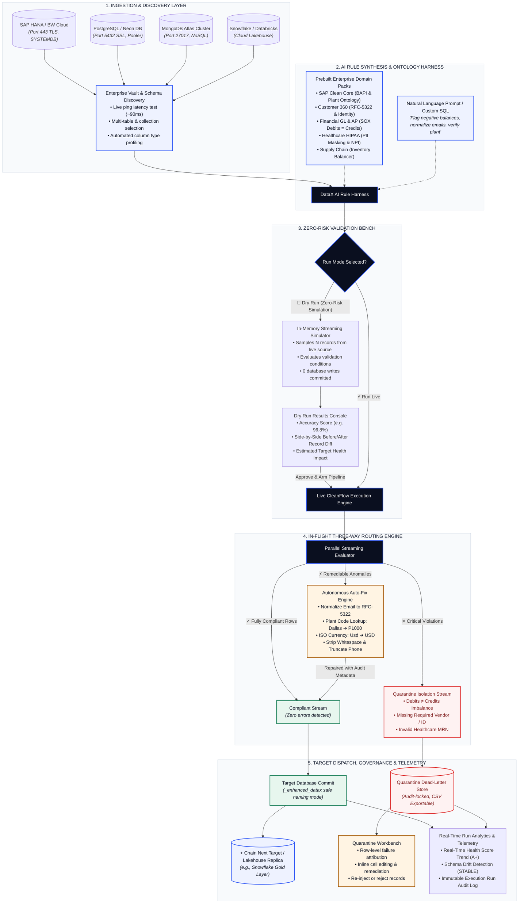
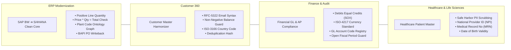

# DataX: Enterprise Business Problem & Architectural Flow

> **Executive Overview**  
> DataX is an autonomous, in-flight data quality and decision intelligence fabric. It replaces brittle, blind ETL/ELT pipelines with self-healing, governed semantic data flows—enabling enterprises to connect legacy sources (SAP BW, MongoDB, PostgreSQL, On-Premises DBs), synthesize domain-certified validation rules via AI, automatically repair data anomalies in transit, and isolate critical violations into an audit workbench without halting operations.

---

## 1. The Enterprise Business Problem: The $3.1 Trillion Data Crisis

According to Gartner and MIT Sloan research, poor data quality costs enterprises an average of **$12.9 million annually**, contributing to an estimated **$3.1 trillion in wasted operational and engineering spend across the US economy**.

```
┌─────────────────────────────────┐       Traditional ELT       ┌─────────────────────────────────┐
│     Dirty / Legacy Sources      │ ──────────────────────────> │   Downstream Critical Systems   │
│ • Unstandardized SAP Plant Codes│      (Blind Ingestion)      │ • Broken S/4HANA BAPI Writebacks│
│ • Invalid Emails & Syntax       │                             │ • Corrupted Financial Ledgers   │
│ • Debit / Credit Imbalances     │                             │ • LLM / AI Model Hallucinations │
│ • Unmasked PII / HIPAA Violations│                            │ • Silent Pipeline Crashes       │
└─────────────────────────────────┘                             └─────────────────────────────────┘
```

### Challenge 1: Blind Ingestion & "Garbage In, Hallucination Out"
Traditional ETL and modern ELT tools (e.g., Fivetran, Airbyte, standard CDC pipelines) are built solely for **data transport**. They move bytes from point A to point B without understanding business domain semantics, field constraints, or ontology. When dirty or drifted records land in modern ERPs, Lakehouses, or AI vector stores:
* **SAP S/4HANA Migrations Fail:** Legacy SAP BW plant codes and missing vendor IDs trigger fatal errors in standard BAPI posting functions (`BAPI_PO_CREATE1`).
* **Financial Ledger Imbalances:** Out-of-balance entries (Debits $\neq$ Credits) and unrecognized ISO currencies violate SOX 404 regulations.
* **Corrupted AI Models:** Enterprise LLMs trained or grounded on dirty source data produce inaccurate forecasts and hallucinations.

### Challenge 2: The Binary Dilemma: Pipeline Crash vs. Silent Data Loss
When standard data pipelines encounter dirty or malformed records, data teams face an unacceptable operational compromise:
* **Option A: Crash the Pipeline:** Halts business operations, triggers cascading SLA violations, and requires on-call data engineers to manually patch jobs in the middle of the night.
* **Option B: Drop Failed Rows Silently:** Avoids pipeline failure but introduces invisible data loss, unreconciled customer accounts, and severe compliance audit penalties.

### Challenge 3: The 70% Engineering Maintenance Tax
Data engineers spend **over 70% of their time** writing custom SQL regex scripts, maintaining brittle dbt tests, manually cleaning dead-letter tables, and fighting schema drift instead of building revenue-generating decision intelligence applications.

### Challenge 4: Lack of Pre-Execution Visibility (The "Black Box" Risk)
Data architects and pipeline developers rarely have a mechanism to preview the impact of newly authored validation rules against live enterprise data before production deployment. Pipeline modifications are routinely pushed to production without dry-run verification.

---

## 2. The DataX Solution: Autonomous CleanFlow

DataX replaces rigid, manual data curation with an **autonomous semantic data quality fabric**:

```
[Connect Any Source] ──> [AI Rule Synthesis] ──> [Zero-Risk Dry Run] ──> [In-Flight CleanFlow] ──> [Safe Target Dispatch]
                                                                                │
                                                                   ┌────────────┼────────────┐
                                                                   ▼            ▼            ▼
                                                                Compliant   Auto-Fixed   Quarantined
                                                                (Passed)    (Repaired)   (Workbench)
```

1. **Prompt-to-Governed Pipeline:** Connect any source and destination (SAP HANA Cloud, PostgreSQL, MongoDB Atlas, Snowflake, Databricks) and generate enterprise-grade validation rules from plain English prompts or certified domain ontologies.
2. **Autonomous In-Flight Auto-Fix:** Automatically self-heals non-breaking anomalies (RFC-5322 email syntax, SAP plant code normalization, casing, whitespace trimming, and ISO currency standardization) in memory.
3. **Quarantine Workbench:** Diverts non-compliant rows into an audit-locked quarantine store with row-level failure attribution, preserving **100% data fidelity without interrupting pipeline execution**.
4. **Zero-Risk Dry Run Simulation:** Evaluates rule logic against sample live records in an isolated memory buffer, providing before/after diffs and accuracy scores before committing changes to production.
5. **Target Safety & Chained Replicas:** Automatically appends safe naming conventions (e.g., `_enhanced_datax`) to prevent overwriting production tables, and allows one-click chaining of secondary lakehouse replicas.

---

## 3. End-to-End Graphical Flow Diagram

The following diagram illustrates the complete DataX pipeline lifecycle, from discovery to multi-hop target dispatch:



---

## 4. In-Flight Three-Way Record Routing Engine

The core operational breakthrough of DataX is its **in-flight three-way classification logic**:

```
                       Incoming Source Record
                                 │
                                 ▼
                     Does record pass all rules?
                                ╱ ╲
                               ╱   ╲
                             YES    NO
                             ╱       ╲
                            ▼         ▼
                    [Clean Stream]   Can anomaly be auto-healed?
                                        ╱ ╲
                                       ╱   ╲
                                     YES    NO
                                     ╱       ╲
                                    ▼         ▼
                            [Auto-Fix Engine] [Quarantine Store]
                                    │                 │
                                    ▼                 ▼
                             Commit to Target   Inspect in Workbench
```

| Stream Path | Trigger Condition | Engine Action | Destination |
| :--- | :--- | :--- | :--- |
| **Stream 1: Clean** | Row satisfies 100% of validation rules. | Streams directly with zero overhead. | Target Production Table (`_enhanced_datax`) |
| **Stream 2: Auto-Fix** | Non-breaking formatting/syntax error detected (e.g., legacy plant code, email casing, whitespace). | Applies ontology lookup & normalization rule; injects audit stamp `_repaired: true`. | Target Production Table (Clean Record) |
| **Stream 3: Quarantine** | Fatal violation detected (e.g., negative quantity, accounting imbalance, missing primary key). | Diverts row immediately without breaking the pipeline; tags specific rule failure ID. | Dead-Letter Quarantine Table & Workbench |

---

## 5. Enterprise Domain Packs Breakdown

DataX provides prebuilt, certified industry domain packs that encode complex regulatory and ERP logic out of the box:



### Detailed Domain Pack Capabilities

```
+----------------------------------------------------------------------------------------------------+
| 1. SAP BW ➔ S/4HANA Clean Core Modernizer                                                          |
| • Problem: Legacy InfoCube lines contain retired plant codes (e.g., 'Dallas') that crash S/4HANA.  |
| • Auto-Fix: Maps legacy plant codes to active SAP codes ('P1000') using ontology knowledge graph.  |
| • Quarantine: Rejects negative quantities or line totals not matching unit_price * quantity.       |
| • Target: Stages clean records for BAPI_PO_CREATE1 execution with lakehouse replication.          |
+----------------------------------------------------------------------------------------------------+
| 2. Financial General Ledger & AP Compliance (SOX & GAAP)                                           |
| • Problem: Legacy disparate accounting systems ingest journal entries with debit/credit imbalance. |
| • Auto-Fix: Normalizes currency codes to ISO-4217 (e.g., 'usd' -> 'USD') and strips bad spaces.   |
| • Quarantine: Immediately isolates unbalanced batches (SUM(DEBIT) != SUM(CREDIT)).                 |
| • Target: Writes approved entries into core ERP ledger with immutable SOX audit log.               |
+----------------------------------------------------------------------------------------------------+
| 3. Customer Master & Identity Harmonizer (Customer 360)                                            |
| • Problem: Raw customer documents from MongoDB Atlas contain duplicate emails and missing names.   |
| • Auto-Fix: Enforces RFC-5322 lowercase email syntax and formats country codes.                     |
| • Quarantine: Rejects records with negative balances or missing required identity fields.          |
| • Target: Merges into single golden record in PostgreSQL / Neon DB.                                |
+----------------------------------------------------------------------------------------------------+
| 4. Healthcare Patient Master & HIPAA Sanitizer                                                     |
| • Problem: Ingested HL7 and EHR records contain exposed PII violating HIPAA Safe Harbor rules.    |
| • Auto-Fix: Formats phone numbers to E.164 and scrubs trailing whitespace in clinical names.       |
| • Quarantine: Flags unverified National Provider Identifiers (NPI) and malformed MRN strings.       |
| • Target: Dispatches de-identified clinical records to HIPAA-compliant analytics warehouse.       |
+----------------------------------------------------------------------------------------------------+
```

---

## 6. Business Impact & ROI Metrics

```
+----------------------------------------------------------------------------------------------------+
| METRIC                       | TRADITIONAL DATA PIPELINES          | WITH DATAX AUTONOMOUS FABRIC  |
+------------------------------+-------------------------------------+-------------------------------+
| Pipeline Interruption Rate   | 15% - 25% of all batch runs fail    | < 0.1% (Zero pipeline halt)   |
| Engineering Maintenance Time | 70% of data team capacity           | < 15% (Autonomous self-healing)|
| Time-to-Deploy New Pipeline  | 3 - 6 weeks (Custom dbt / SQL)      | < 5 minutes (Prompt + Packs)  |
| Silent Data Loss             | Unmeasured (dropped dirty rows)     | 0% (Full Quarantine tracking) |
| Target Data Safety           | High risk of accidental overwrite   | 100% collision-safe naming    |
| Audit Readiness              | Days spent compiling log extracts   | Instant row-level lineage     |
+------------------------------+-------------------------------------+-------------------------------+
```

### Quantifiable Enterprise Return on Investment (ROI)
1. **$420,000+ Annual Engineering Savings per Data Team (5 FTEs):** Reclaims thousands of hours spent troubleshooting broken ETL jobs and rewriting custom regex scripts.
2. **Elimination of Broken ERP Migrations:** Prevents multi-million-dollar downtime during SAP S/4HANA, Salesforce, or Workday enterprise go-lives.
3. **Continuous Regulatory Compliance:** Provides compliance officers with complete, immutable audit logs of every clean, repaired, and quarantined record for SOX, HIPAA, and GDPR inspections.

---

> [!NOTE]
> **Live Verification & Access**  
> DataX is deployed and running live on production:
> * **Threads Dashboard:** [https://dataglow.ai/datax/#threads](https://dataglow.ai/datax/#threads)
> * **Domain Packs Catalog:** [https://dataglow.ai/datax/#domain-packs](https://dataglow.ai/datax/#domain-packs)
> * **Connections & Vault:** [https://dataglow.ai/datax/#connections](https://dataglow.ai/datax/#connections)
> * **Run Execution History:** [https://dataglow.ai/datax/#history](https://dataglow.ai/datax/#history)
