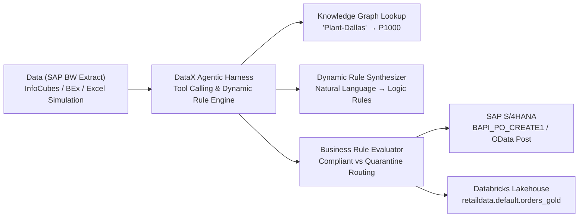

# DataGlow.ai — Enterprise Semantic Platform & DataX Decision Intelligence

Welcome to the **DataGlow.ai** company website and **DataX Platform** Decision Intelligence POC.

---

## 🌟 Executive Overview

DataGlow.ai delivers the enterprise semantic foundation and autonomous decision intelligence for Global 2000 data estates. We solve the fundamental problem of enterprise data opacity by unifying:
1. **Enterprise Ontologies & Knowledge Graphs**: Resolving multi-system semantic ambiguity across ERPs and warehouses.
2. **Agentic Harness & Tool Calling**: Autonomous goal-driven agents that reason, invoke verified enterprise tools, and execute self-correcting validation loops.
3. **Enterprise Modernization & Decision Intelligence**: Connecting legacy SAP BW / ECC into operational **SAP S/4HANA** transactions and analytical **Databricks Lakehouse** assets.

---

## 🚀 Two Production Products

| Product | Focus | Key Capabilities |
| :--- | :--- | :--- |
| **DataGlow Continuum** | Enterprise AI Data Readiness | Automated Data Quality Index (DQI), Dynamic Drift Forecasting, Cross-Model Consistency, Meridian Lineage Audit, and Remediation Agents. |
| **DataX Platform** | Decision Intelligence & Data Transformation | End-to-End Autonomous Transformation Pipeline: `SAP BW → Agentic Rule Engine (Tool Calling) → SAP S/4HANA → Databricks`. |

---

## 🏗️ Architecture: The DataX Transformation Pipeline



### Flow Breakdown
1. **Source Data (SAP BW)**:
   - Ingests raw batch extracts (e.g., InfoCube `0PUR_C01` procurement orders, stock ledger).
   - Simulates real-world legacy data quirks and anomalies using included Excel & CSV datasets (`sap_bw_procurement_extract.xlsx`, `sap_bw_inventory_extract.xlsx`).
2. **Agentic Business Validation (Agent Harness & Tool Calling)**:
   - Autonomous ReAct Agent Loop: `THOUGHT → TOOL_CALL → OBSERVATION → REFLECTION`.
   - **Tool `ontology_graph_lookup`**: Traverses knowledge graph to map legacy location strings (e.g., `Plant-Dallas` → `P1000`).
   - **Tool `dynamic_rule_synthesizer`**: Synthesizes domain business rules from business intent.
   - **Tool `business_rule_evaluator`**: Executes rules across the batch, quarantining violations (negative quantities, amount mismatches, missing vendors).
3. **Operational ERP Writeback (SAP S/4HANA)**:
   - **Tool `s4hana_payload_builder`**: Generates schema-compliant `BAPI_PO_CREATE1` / OData payloads.
   - Governance Gate: 1-Click human verification with budget ceiling safeguards.
   - Generates simulated SAP confirmation receipt (Document `#4500019284`, latency `38ms`).
4. **Analytical Lakehouse (Databricks)**:
   - **Tool `databricks_delta_writer`**: Persists compliant records into Databricks Unity Catalog (`retaildata.default.sap_bw_modernized_gold`).
   - Strict typing (BIGINT, DOUBLE, TIMESTAMP, native SQL NULLs) and partition pruning.

---

## 💻 Quick Start & Running Locally

### 1. Web Application (Company Website & Interactive DataX POC)

```bash
# Navigate to project directory
cd "h:\AAVIL Inc\DataX\DataX"

# Dependencies are already installed! Start development server:
npm run dev

# Or build production bundle:
npm run build
```

Open your browser at:
- `http://localhost:5173/` — **DataGlow.ai Company Website** (Hero, Products Showcase, Expertise, Architecture)
- `http://localhost:5173/#poc` — **Live Interactive DataX POC Platform**

### 2. Standalone Python Agent Harness

To run the autonomous agent tool-calling loop in your terminal:

```bash
python agent_harness.py
```

---

## 📂 Project Structure

```
h:\AAVIL Inc\DataX\DataX/
├── agent_harness.py             # Autonomous Python agentic harness with tool calling
├── index.html                   # HTML entrypoint with Outfit & Inter typography
├── package.json                 # React, Vite, Lucide, Tailwind, SheetJS dependencies
├── vite.config.js               # Vite bundler configuration
├── tailwind.config.js           # Custom enterprise dark theme & glow utilities
├── public/
│   └── sample_data/             # Preloaded SAP BW Excel & JSON datasets
│       ├── sap_bw_procurement_extract.xlsx
│       ├── sap_bw_procurement_extract.json
│       ├── sap_bw_inventory_extract.xlsx
│       └── sap_bw_inventory_extract.json
└── src/
    ├── App.jsx                  # Main application router (Website vs POC switcher)
    ├── index.css                # Global styles, glassmorphism, glowing gradients
    ├── main.jsx                 # React root renderer
    ├── data/
    │   ├── ontologyGraph.js     # Enterprise Knowledge Graph & plant resolver
    │   └── sampleDatasets.js    # Preloaded SAP BW dataset definitions
    ├── components/
    │   ├── common/
    │   │   ├── Navbar.jsx       # Universal responsive navbar with product dropdowns
    │   │   └── Footer.jsx       # Corporate footer with platform links & certification
    │   ├── website/
    │   │   ├── Hero.jsx         # High-impact hero section with product spotlights
    │   │   ├── ProductsSection.jsx   # Continuum vs DataX deep dive
    │   │   ├── ExpertiseSection.jsx  # Ontologies, Knowledge Graphs & Agent Harness
    │   │   ├── ArchitecturePipeline.jsx # Interactive 4-step pipeline inspector
    │   │   ├── CaseStudiesSection.jsx   # Fortune 50 enterprise results
    │   │   └── BookDemoModal.jsx        # Enterprise briefing scheduler
    │   └── poc/
    │       └── DataXPoc.jsx     # Complete Decision Intelligence Platform POC
```
