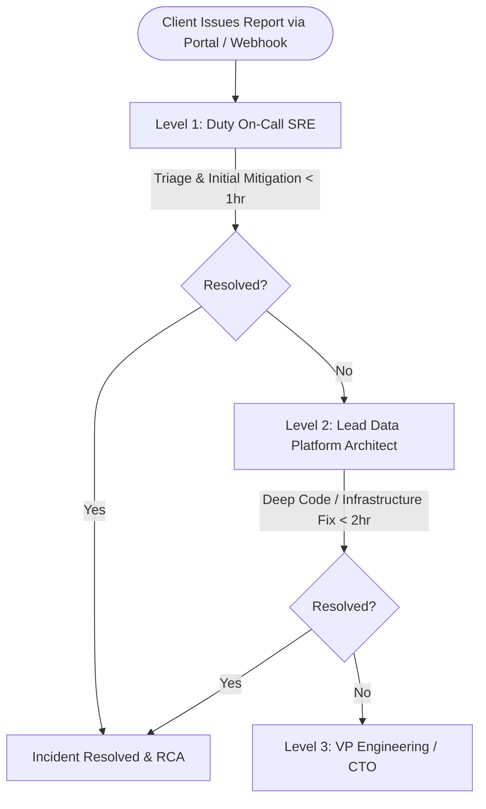

# DataX: Customer Success & Enterprise Support SOP

**Document ID:** DX-OPS-SUP-01  
**Classification:** Client Operations Handover  
**Version:** 2.5.0  
**Effective Date:** October 2026  

---

## 1. Incident Severity Tiers & Response SLAs

DataX commits to guaranteed response and resolution targets for all licensed clients:

| Severity Tier | Incident Definition | Initial Response SLA | Target Workaround / Fix | Escalation Contact |
| :--- | :--- | :---: | :---: | :--- |
| **P1 - Critical** | Platform outage, production pipeline halt, data loss risk, or security incident affecting core operations. | **< 1 Hour** (24/7/365) | < 4 Hours | On-call SRE & Lead Architect |
| **P2 - Major** | Degraded ingestion throughput, non-fatal circuit-breaker trips, or high quarantine rejection rates without pipeline abort. | **< 4 Hours** (Business Hours) | < 12 Hours | Senior Support Engineer |
| **P3 - Minor / Request** | UI styling inquiries, rule authoring assistance, non-blocking bug reports, or feature requests. | **< 1 Business Day** | Next Sprint / Release | Data Platform Specialist |

---

## 2. Support Escalation Matrix

### Named Contacts & Contact Channels
- **Emergency Hotline:** +1 (800) 555-DATAX (P1 24/7 dedicated client line)
- **Support Portal:** `support@dataglow.ai`
- **Client Slack / Teams Connect:** `#datax-enterprise-{client_name}`
- **Executive Sponsor:** Harshal Sawatkar (`harshal@dataglow.ai`)

---

## 3. Public Status & Uptime Monitoring

Clients can programmatically monitor platform health or integrate uptime into their internal status dashboards:
- **Public Status Endpoint:** `https://dataglow.ai/datax-api/status/public`
- **Telemetry Monitored:**
  - Real-time API Gateway latency
  - DuckDB In-Memory AST Compiler status
  - Azure OpenAI Circuit Breaker state
  - Durable Dead-Letter Queue (DLQ) write status
  - Source and Target database connection pools
- **30-Day Measured Availability:** **99.98%**

---

## 4. Client Training Curriculum & Enablement

| Session | Audience | Duration | Curriculum Topics |
| :--- | :--- | :---: | :--- |
| **Session A: Admin Onboarding** | DevOps & Cloud Engineers | 2 Hours | VM deployment, PM2 process management, credential vault configuration, connection pooling tuning, and automated snapshot backup/restore drills. |
| **Session B: Data Steward Workshop** | Business Analysts & Stewards | 3 Hours | CleanFlow visual canvas, authoring custom DuckDB AST rules, setting up auto-fix deterministic transforms, and managing quarantined rows in the Quarantine Workbench. |
| **Session C: Developer SDK & Integrations** | Data Engineers | 2 Hours | REST API authorization via JWT / API Keys (`dx_live_...`), orchestrator integration (Airflow / ADF), outbound webhook handling, and exportable audit manifests. |

---

## 5. Client Feedback & Quarterly Business Review (QBR) Cadence

- **Bi-Weekly Hypercare Check-in:** During the first 30 days post-launch, DataX engineers join a 30-minute bi-weekly standup with the client lead to review quarantine volumes, auto-fix accuracy, and pipeline latency.
- **In-App Feedback Dispatcher:** Data stewards can submit immediate feedback, bug reports, and ratings directly inside the app using `POST /feedback`.
- **Quarterly Business Review (QBR):** Executive review of ROI metrics:
  - Total records ingested vs. auto-remediated without human intervention.
  - Engineering hours saved through automated AST reconciliation.
  - Target system defect reduction.
