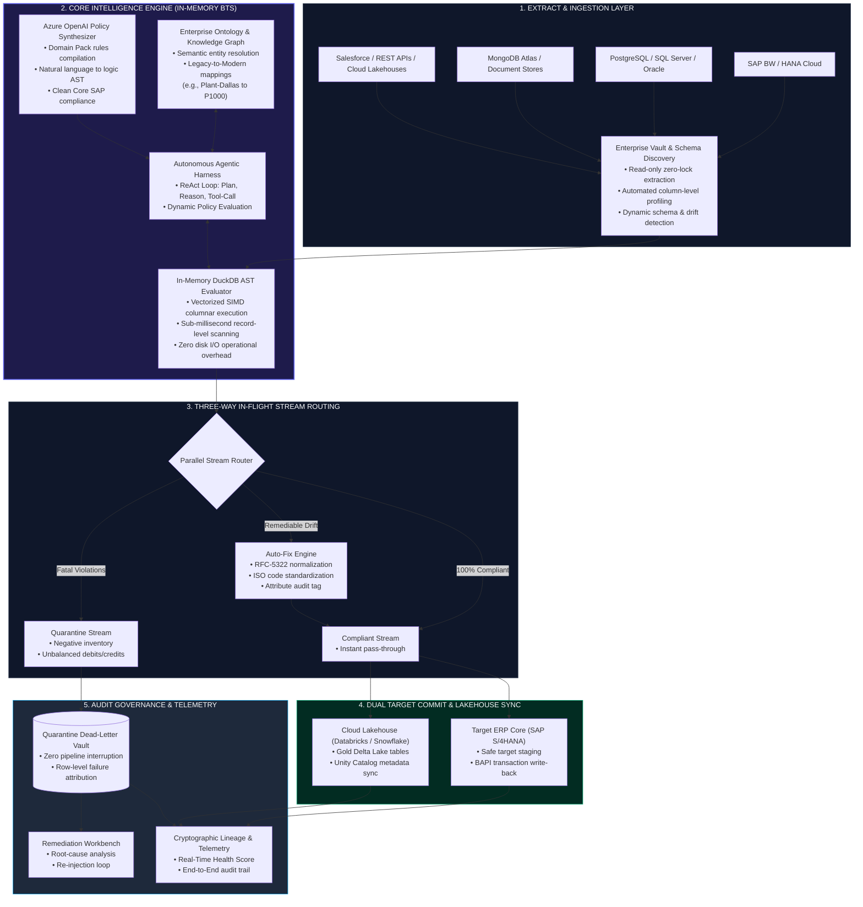

# DataX Platform Architecture & Behind-The-Scenes (BTS) Engine

The DataX platform is an autonomous, in-flight data quality and decision intelligence fabric. It eliminates brittle, manual data pipelines by decoupling business semantics from transport layers—enabling enterprises to connect heterogeneous sources, evaluate policies in-memory, self-heal anomalies, and persist clean data to downstream targets without operational downtime.

---

## 1. High-Level Architectural Topology



---

## 2. Behind-The-Scenes (BTS) Layer Breakdown

### Layer 1: Zero-Lock Ingestion & Schema Profiling
* **Non-Invasive Extraction:** Connects to legacy data systems (SAP BW tables, relational databases, NoSQL stores, or cloud object stores) using read-only service accounts with zero locks on operational transaction tables.
* **Metadata Profiling:** Upon stream initialization, the engine computes column type distribution, cardinality, null density, and string length metrics in real time.

---

### Layer 2: The Core Intelligence Engine
The Intelligence Engine replaces traditional, static rule scripts with an autonomous, in-process processing pipeline:

```
[ Incoming Record Stream ]
           │
           ▼
┌────────────────────────────────────────────────────────────────────────┐
│  IN-MEMORY DUCKDB AST COMPILER                                         │
│  • Compiles domain rules into vectorized AST (Abstract Syntax Tree)   │
│  • Performs zero-copy columnar evaluations at line rate                │
└──────────────────┬─────────────────────────────────────────────────────┘
                   │
                   ▼ (For semantic anomalies & unmapped entities)
┌────────────────────────────────────────────────────────────────────────┐
│  SEMANTIC ONTOLOGY & KNOWLEDGE GRAPH                                   │
│  • Resolves ambiguous references (e.g., 'Plant-Dallas' ➔ S/4HANA 'P1000')│
│  • Validates ISO codes, country standards, and Master Data hierarchies │
└──────────────────┬─────────────────────────────────────────────────────┘
                   │
                   ▼ (For complex edge cases)
┌────────────────────────────────────────────────────────────────────────┐
│  AGENTIC HARNESS (ReAct LOOP)                                          │
│  • Thought ➔ Tool Call (lookup / calculate) ➔ Observation ➔ Verify     │
│  • Generates deterministic fixes with immutable audit reasoning        │
└────────────────────────────────────────────────────────────────────────┘
```

1. **In-Memory DuckDB AST:** Rather than shipping queries back and forth to an external database, the engine compiles rules into in-process abstract syntax trees (ASTs). This guarantees microsecond-level record evaluation across hundreds of thousands of rows.
2. **Enterprise Domain Ontologies:** Encodes industry semantics directly into the engine (e.g., SAP Clean Core, Customer 360, SOX Compliance, Healthcare FHIR). 
3. **Agentic ReAct Loop:** When an unmapped or ambiguous entry is detected (e.g., legacy plant names or drifted foreign keys), the agent reasons through its tool-calling harness to determine the correct target representation before deciding the route.

---

### Layer 3: The Three-Way In-Flight Stream Router
Unlike traditional pipelines that crash on the first dirty record or silently drop rows, DataX evaluates every row through a concurrent three-way stream router:

```
                            Record Evaluated
                                   │
         ┌─────────────────────────┼─────────────────────────┐
         ▼                         ▼                         ▼
   [ Route 1: Clean ]      [ Route 2: Auto-Fix ]    [ Route 3: Quarantine ]
   • Meets 100% of rules   • Remediable anomaly      • Severe violation
   • Instant pass-through  • Healed in-memory        • Isolated immediately
                           • Injects audit stamp     • Pipeline keeps running
```

* **Route 1: Clean Pass:** Records meeting all schema, referential, and business constraints stream directly to the target.
* **Route 2: Autonomous Auto-Fix:** Records with remediable anomalies (e.g., trailing whitespace, non-standard email casing, ISO code conversions, or ontology-mapped plant codes) are repaired in-flight. The engine stamps each row with `_repaired: true` and an audit trace describing the correction.
* **Route 3: Zero-Interruption Quarantine:** Fatal violations (e.g., negative inventory, accounting ledger imbalances where Debits $\neq$ Credits, missing primary keys) are routed to an isolated quarantine store. **The pipeline does not fail or halt**, protecting downstream SLA deadlines while guaranteeing 0% data loss.

---

### Layer 4: Target Commit & Dual Synchronization
* **Safe Target Commit:** Staged records are committed to production systems using safe isolation patterns (e.g., staging tables or verified BAPI posting endpoints) to protect active master tables.
* **Lakehouse Synchronization:** Concurrently replicates clean records to analytics lakehouses (Databricks Delta Lake, Snowflake, BigQuery) with ACID transactional integrity, making data immediately available for BI dashboards and AI training models.

---

### Layer 5: Quarantine Workbench & End-to-End Lineage
* **Quarantine Workbench:** Data stewards can inspect quarantined records, view the specific policy rule that flagged them, and review suggested AI corrections. Corrected rows can be re-injected into the target system with a single click.
* **Cryptographic Lineage:** Every executed pipeline creates an immutable execution trace:
  $$\text{Source Checksum} \longrightarrow \text{Rule Evaluation Manifest} \longrightarrow \text{Routing Trace} \longrightarrow \text{Target Commit Hash}$$
* **Executive Telemetry:** Provides live operational health scores, throughput metrics, and real-time alerts if upstream schema drift occurs.

---

## 3. Architecture Comparison Matrix

| Architectural Capability | Legacy ETL / ELT | Custom Data Engineering Scripts | **DataX Intelligence Engine** |
| :--- | :--- | :--- | :--- |
| **Logic Layer** | Hardcoded regex / SQL scripts | Brittle, disparate dbt models | **Ontology-grounded, dynamic AST compiler** |
| **Pipeline Failure Behavior** | Hard crash or silent row drops | Pipeline halts; on-call engineer alerted | **Zero-interruption Quarantine routing** |
| **Data Self-Healing** | None (manual remediation) | Ad-hoc Python transforms | **Autonomous in-memory Auto-Fix engine** |
| **Execution Overhead** | Multi-hop disk persistence | Heavy compute cluster queries | **Zero-copy, in-memory vectorized execution** |
| **Domain Extensibility** | Rebuild pipeline from scratch | Rewrite logic and schemas per domain | **Pluggable Domain Packs (SAP, CRM, Finance, HIPAA)** |
| **Observability** | Basic row count logs | Custom monitoring alerts | **Row-level failure attribution & audit lineage** |
