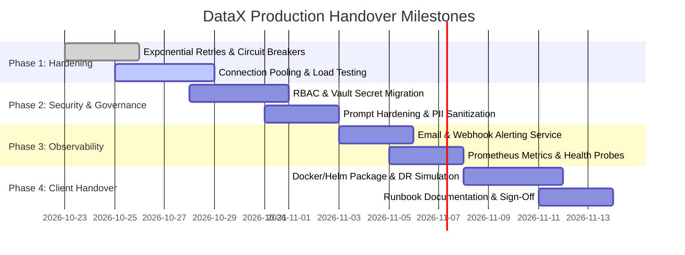

# DataX: Enterprise Production Readiness & Client Handover Checklist

This document outlines the end-to-end technical, operational, and architectural requirements necessary to transition DataX from staging/pilot status into a hardened, enterprise-grade production deployment.

---

## 1. Resilience, Fault Tolerance & Reliability

| ID | Item | Priority | Implementation Scope | Definition of Done (DoD) |
| :--- | :--- | :---: | :--- | :--- |
| **REL-01** | **Exponential Backoff & Jitter Retries** | **P0** | Wrap all external connector calls (SAP BAPI, Postgres, Mongo, Azure OpenAI) with retry logic (`tenacity` in Python, 3-5 retries, base 2s with random jitter). | Transient network drops or rate-limit HTTP 429s automatically recover without pipeline failure. |
| **REL-02** | **Circuit Breaker Pattern** | **P0** | Implement circuit breakers (`pybreaker`) on target DB writes and LLM endpoints. If failure rate > 50% over 1 min, open circuit to avoid resource exhaustion. | Downstream failure fails fast with graceful fallback rather than hanging worker threads. |
| **REL-03** | **Idempotent Pipeline Execution** | **P0** | Attach a deterministic `execution_id` / idempotency key to each run. Ensure target DB staging/writes use upsert / merge keys (`ON CONFLICT DO UPDATE` or staging-then-swap). | Re-running a failed or aborted pipeline never creates duplicate rows in target systems. |
| **REL-04** | **Dead-Letter Queue (DLQ) Durability** | **P1** | Ensure Quarantine records are written to durable storage (PostgreSQL/DuckDB file) with disk write sync, not volatile in-memory queues alone. | Process crashes or server restarts retain 100% of quarantined records for audit inspection. |
| **REL-05** | **Offline Fallback for AI Logic** | **P1** | Cache compiled rule ASTs and domain pack heuristics locally. If Azure OpenAI is unreachable, fallback to deterministic regex/AST rules. | Core data cleansing and validation continue operating even during cloud AI outages. |

---

## 2. Performance & Scalability Benchmarking

| ID | Item | Priority | Implementation Scope | Definition of Done (DoD) |
| :--- | :--- | :---: | :--- | :--- |
| **PRF-01** | **High-Throughput Load Testing** | **P0** | Benchmark ingestion, DuckDB AST evaluation, and target commit against 100K, 500K, and 1M record datasets using Locust or k6. | Sustained throughput $\ge$ 5,000 rows/sec; p95 latency under 15ms per batch; 0 dropped rows. |
| **PRF-02** | **Memory Leak & Footprint Profiling** | **P0** | Run `memray` or `tracemalloc` across 1,000 consecutive runs. Ensure batch garbage collection explicitly flushes PyArrow/DuckDB buffers. | Memory usage plateaus under 512MB RAM without creeping up over time. |
| **PRF-03** | **Database Connection Pooling** | **P0** | Replace ad-hoc connection instances with an enterprise connection pool (`asyncpg` pool or SQLAlchemy pooled sessions with max pool size = 20, max overflow = 10). | No "too many connections" errors under 50 concurrent tenant requests. |
| **PRF-04** | **Streaming / Chunked Iterators** | **P1** | Replace `read_all()` calls with cursor-based streaming generators (batch size = 5,000) for source extraction and target commits. | Large multi-gigabyte extracts process with constant memory footprint regardless of dataset size. |
| **PRF-05** | **Frontend Graph & Table Virtualization** | **P1** | Virtualize canvas DOM elements and table inspectors (`@tanstack/react-virtual` or CSS content-visibility) for runs with > 1,000 rows. | Canvas maintains 60 FPS scrolling and inspection without browser freezing. |

---

## 3. Enterprise Security & Access Governance

| ID | Item | Priority | Implementation Scope | Definition of Done (DoD) |
| :--- | :--- | :---: | :--- | :--- |
| **SEC-01** | **Role-Based Access Control (RBAC)** | **P0** | Enforce 4 discrete permission tiers: `Admin` (full system access), `Data Steward` (rule editing & quarantine resolution), `Operator` (trigger & view runs), `Auditor` (read-only logs). | API endpoints enforce JWT claim verification; unauthorized operations return HTTP 403. |
| **SEC-02** | **Production Secret Management** | **P0** | Migrate plaintext credentials from local files and `.env` to Azure Key Vault, AWS Secrets Manager, or HashiCorp Vault. | Zero hardcoded API keys or DB passwords in source code or client configs. |
| **SEC-03** | **TLS 1.3 & At-Rest Encryption** | **P0** | Enforce HTTPS/TLS 1.3 across all Nginx endpoints; encrypt all stored credentials in Vault using AES-256-GCM with envelope encryption. | Qualys SSL Labs rating of A+; zero plain-text passwords stored in the database. |
| **SEC-04** | **Prompt & Query Injection Hardening** | **P0** | Sanitize all user-entered natural language prompts and rule strings against SQL/AST injection. Disallow raw DDL (`DROP`, `TRUNCATE`, `ALTER`) in generated logic. | Malicious prompt tests fail gracefully without altering schema or executing unintended statements. |
| **SEC-05** | **Automated PII / Sensitive Data Masking** | **P1** | Automatically detect and mask SSNs, credit cards, and HIPAA identifiers in execution logs and telemetry views before persistence. | Telemetry and public log streams contain no raw unmasked PII. |
| **SEC-06** | **CORS & Rate Limiting** | **P1** | Restrict CORS `allow_origins` strictly to client domains; configure rate-limiting (`slowapi` / Nginx `limit_req`) to 60 req/min per IP. | Brute force or API flooding triggers HTTP 429 without service degradation. |

---

## 4. Observability, Alerting & Email Integration

| ID | Item | Priority | Implementation Scope | Definition of Done (DoD) |
| :--- | :--- | :---: | :--- | :--- |
| **OBS-01** | **Multi-Channel Alert Dispatcher** | **P0** | Implement an alerting service supporting SMTP/Email (SendGrid/AWS SES/corporate SMTP) and Slack/Teams Incoming Webhooks. | Critical alerts deliver within 30 seconds of an incident. |
| **OBS-02** | **Configurable Alert Thresholds** | **P0** | Allow data teams to define alert policies: (a) Pipeline failure, (b) Quarantine rate > $X\%$, (c) Connector timeout, (d) Schema drift detected. | Breaching an alert condition sends formatted HTML summary with direct link to the run audit. |
| **OBS-03** | **Health Probes (Liveness & Readiness)** | **P0** | Expose `/health/live` (process alive) and `/health/ready` (validates DB connectivity, AI API ping, disk space > 10%). | Orchestrators (Kubernetes / Docker) automatically detect unresponsive pods and restart them. |
| **OBS-04** | **Structured JSON Logging** | **P1** | Convert all `print` and ad-hoc logging to structured JSON logs (`structlog` or `loguru`) containing `trace_id`, `pipeline_id`, `tenant_id`, and `duration_ms`. | Logs are ingestible into Datadog, Splunk, CloudWatch, or ELK stack for rapid querying. |
| **OBS-05** | **Prometheus Metrics Endpoint** | **P1** | Expose standard `/metrics` endpoint exporting: `pipeline_runs_total`, `pipeline_duration_seconds`, `quarantine_records_total`, `active_connections`. | Out-of-the-box Grafana dashboard displays real-time platform metrics. |

---

## 5. Architectural Optimization & Data Governance

| ID | Item | Priority | Implementation Scope | Definition of Done (DoD) |
| :--- | :--- | :---: | :--- | :--- |
| **ARC-01** | **Target Safe Staging Protocol** | **P0** | Enforce staging pattern: write into `_staged_datax` temporary tables, perform consistency checks, and execute atomic rename or merge. | Target production tables are never left in a partial, dirty, or corrupted state during run failures. |
| **ARC-02** | **Data Retention & Lifecycle Policies** | **P1** | Implement automated purge/archive cron job for old execution logs and resolved quarantine records (e.g., 30-day active, 90-day cold archive). | Database storage does not bloat indefinitely over months of heavy execution. |
| **ARC-03** | **Database Index Optimization** | **P1** | Ensure all foreign keys, run IDs, thread IDs, and timestamp queries have composite indexes (`pipeline_id`, `created_at DESC`). | Querying run histories or quarantine workbench takes < 50ms even with millions of historical rows. |
| **ARC-04** | **Audit Trail Immutability** | **P1** | Store pipeline execution runs with cryptographic hash manifests (`sha256(source + rules + output)`). | Audit logs satisfy compliance standards (SOC 2, ISO 27001, SOX 404). |

---

## 6. Client Handover & Operational Deliverables

| ID | Item | Priority | Implementation Scope | Definition of Done (DoD) |
| :--- | :--- | :---: | :--- | :--- |
| **OPS-01** | **Automated Deployment Package** | **P0** | Complete Docker Compose and Helm charts with configurable environment variables and zero manual server interventions. | `docker compose up -d` boots the entire stack cleanly on client cloud infrastructure. |
| **OPS-02** | **Comprehensive Operations Runbook** | **P0** | Step-by-step documentation for backup/restore, certificate rotation, connector credential updates, and node scaling. | Client DevOps team can perform maintenance and recovery without vendor assistance. |
| **OPS-03** | **Client User & Architecture Manual** | **P1** | Executive architecture overview, domain pack authoring guide, and quarantine resolution SOP with screenshots. | Client business analysts and data stewards can author rules and manage quarantine independently. |
| **OPS-04** | **Disaster Recovery (DR) Simulation** | **P1** | Execute a full disaster recovery dry run: simulate VM/container termination mid-pipeline and verify zero data corruption. | System recovers in < 3 minutes with automated reconciliation of in-flight jobs. |
| **OPS-05** | **SLA & Acceptance Sign-off Matrix** | **P1** | Pre-agreed performance, uptime (99.9%), and accuracy benchmarks verified across test datasets. | Formal client sign-off achieved. |

---

## 7. Handover Milestone Roadmap

